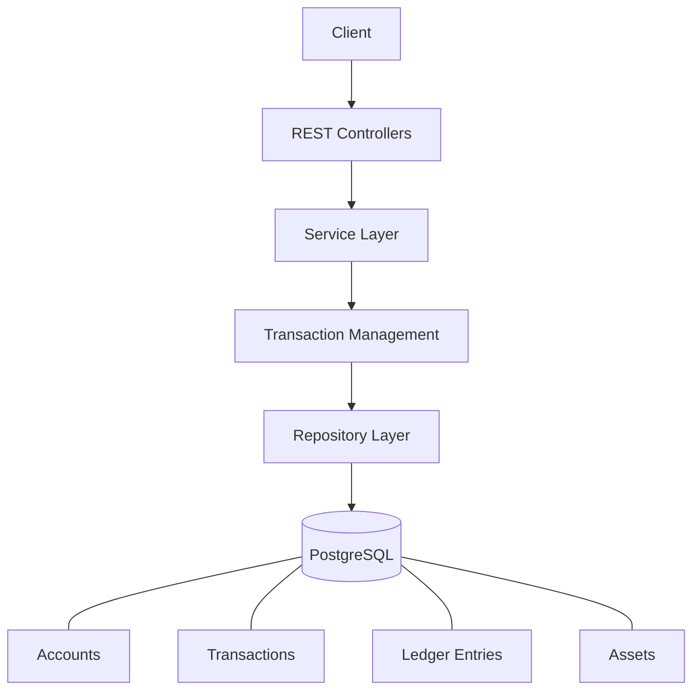
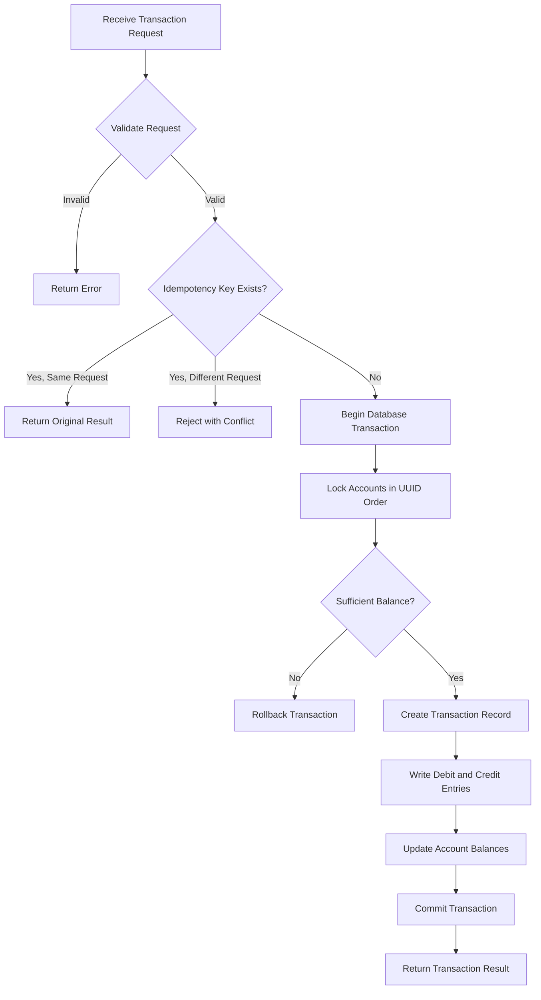
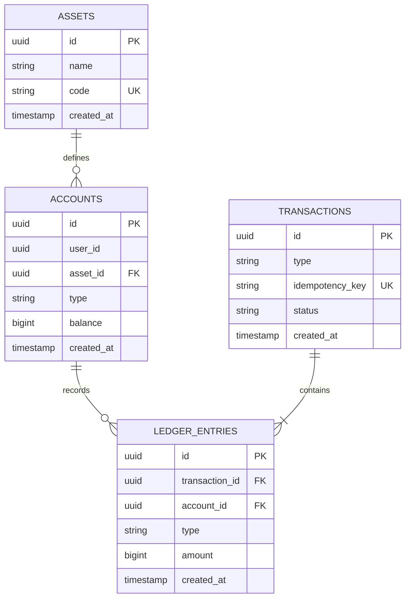

# PayPulse — Ledger-Based Wallet Service

**A concurrency-safe virtual wallet backend built with Java, Spring Boot, and PostgreSQL.**

PayPulse is a transactional wallet service for applications that manage virtual currencies, gaming credits, and loyalty rewards. It supports atomic balance updates, double-entry ledger accounting, pessimistic locking, and idempotent transaction processing to maintain consistency under concurrent requests.

<p align="center">
  
  
  
  
  
</p>

## Overview

PayPulse is designed around a simple principle: **every balance movement must be consistent, traceable, and safe to retry.**

Instead of relying solely on balance updates, the service records transactions through a double-entry ledger while maintaining an account balance for efficient reads.

### Core Capabilities

- **Double-entry accounting** — Every successful transfer produces corresponding debit and credit entries.
- **Atomic transactions** — Database transactions keep related account and ledger updates consistent.
- **Concurrency safety** — Pessimistic row-level locking protects balances during simultaneous operations.
- **Idempotent processing** — Unique idempotency keys prevent duplicate transaction execution.
- **Deadlock mitigation** — Accounts are locked in a consistent UUID order.
- **Multi-asset wallets** — Supports Gold Coins, Diamonds, and Loyalty Points.
- **Transaction history** — Provides a chronological audit trail of wallet activity.
- **Containerized setup** — Docker Compose simplifies local development.

## Live Demo

- **Swagger UI:** [Explore the API](https://internalwalletservice.onrender.com/swagger-ui/index.html)

> The live endpoint depends on the availability of the hosted deployment.

## Architecture



### Layer Responsibilities

| Layer | Responsibility |
|---|---|
| REST Controllers | Request handling, validation, and HTTP responses |
| Service Layer | Transaction orchestration and business rules |
| Transaction Management | Atomic execution and consistency |
| Repository Layer | Persistence and pessimistic locking |
| PostgreSQL | Durable storage, constraints, and relational integrity |

## Transaction Lifecycle

A wallet operation follows a controlled transaction flow.



The service validates requests, handles duplicate submissions, acquires the necessary account locks, records ledger movements, and commits the related changes atomically.

## Technology Stack

| Technology | Role |
|---|---|
| Java 21 | Backend implementation |
| Spring Boot | Application framework and REST APIs |
| Spring Data JPA | Persistence and repository abstractions |
| PostgreSQL 16 | ACID-compliant relational database |
| Pessimistic Locking | Protection against conflicting balance updates |
| Docker Compose | Local application and database orchestration |
| Swagger / OpenAPI | API exploration and documentation |

## Data Model

The persistence layer is built around four core entities.



### Design Decisions

- **Assets:** Define the virtual currencies supported by the application.
- **Accounts:** Represent user or system wallets for a specific asset.
- **Transactions:** Store transaction metadata, status, and idempotency information.
- **Ledger entries:** Record the individual debit and credit sides of each transaction.

The account balance acts as a cached value for efficient reads, while ledger entries provide the transaction-level audit trail.

For a balanced double-entry transaction, the total signed movement across the affected accounts must equal zero. This invariant assumes debit and credit amounts use consistent units and sign conventions.

## API Reference

### 1. Process a Transaction

`POST /api/v1/transactions`

Processes a top-up, bonus, or spending operation.

**Supported operations**

| Type | Description |
|---|---|
| `TOPUP` | Adds virtual credits to an account |
| `BONUS` | Credits promotional rewards |
| `SPEND` | Deducts virtual credits from an account |

**Request body**

```json
{
  "type": "TOPUP",
  "email": "example@email.com",
  "assetCode": "GOLD_COINS",
  "amount": 100,
  "idempotencyKey": "unique-key-123"
}
```

| Field | Type | Description |
|---|---|---|
| `type` | String | Transaction type |
| `email` | String | Identifies the target user |
| `assetCode` | String | Virtual asset identifier |
| `amount` | Long | Positive transaction amount |
| `idempotencyKey` | String | Unique key for safe retries |

**Example response**

```json
{
  "transactionId": "550e8400-e29b-41d4-a716-446655440000",
  "transactionType": "TOPUP",
  "amount": 100,
  "balanceAfter": 600,
  "status": "SUCCESS",
  "createdAt": "2026-02-22T12:00:00Z"
}
```

**Expected status codes**

| Status | Meaning |
|---|---|
| `201 Created` | New transaction successfully processed |
| `200 OK` | Previously processed matching request |
| `400 Bad Request` | Invalid request or insufficient balance |
| `404 Not Found` | Referenced user, asset, or account not found |
| `409 Conflict` | Idempotency conflict or lock acquisition failure |

Actual status codes depend on the implemented exception-handling rules.

### 2. Get Wallet Balance

`GET /api/v1/wallet/balance?email={email}&assetCode={assetCode}`

Retrieves the balance of a particular asset for a specified user.

### 3. Get Transaction History

`GET /api/v1/transactions?email={email}`

Returns the user's transactions in reverse chronological order, including the relevant transaction details and wallet movements.

For interactive request and response schemas, use the [Swagger UI](https://internalwalletservice.onrender.com/swagger-ui/index.html).

## Engineering Deep Dive

### 1. Concurrency Control

**Problem:** Two concurrent spending requests can read the same balance and both approve a debit, causing an incorrect balance or overspending.

**Solution:** Acquire a pessimistic write lock before validating and modifying account balances.

```java
@Lock(LockModeType.PESSIMISTIC_WRITE)
```

The database row lock ensures that competing operations on the same account are serialized. A subsequent request reads the updated balance after the previous transaction completes.

### 2. Deadlock Prevention

A transaction can involve two accounts, such as a wallet and a treasury account. Locking them in inconsistent orders can create a deadlock.

PayPulse mitigates this by acquiring account locks in ascending UUID order, regardless of the transaction direction.

### 3. Idempotency

Network failures can cause clients to retry requests even when the original transaction has already succeeded.

PayPulse uses a unique idempotency key to distinguish a retry from a new operation.

- Matching key and request: return the original result.
- Matching key with different request details: reject the request.
- New key: process and persist the transaction.

A database uniqueness constraint provides an additional safeguard against duplicate transaction records. Correct handling of concurrent duplicate requests also requires appropriate database error and transaction handling.

### 4. Atomic Ledger Updates

The transaction record, ledger entries, and account balance updates must be committed together.

If a failure occurs before commit, the database transaction should roll back the associated changes rather than leave a partially recorded wallet operation.

## Getting Started

### Prerequisites

- Java 21
- PostgreSQL 16, if running without Docker
- Docker and Docker Compose, for containerized setup

### Option 1: Docker Compose

Clone the repository and enter the project directory.

```bash
git clone <your-repository-url>
cd PayPulse
docker-compose up --build
```

This starts the configured database and application services and initializes seed data when the PostgreSQL data volume is first created.

Once the application starts:

- **API Base URL:** `http://localhost:8080`
- **Swagger UI:** `http://localhost:8080/swagger-ui/index.html`

Use the exact Swagger path configured by your application if it differs from this default.

### Option 2: Manual Setup

Create the database:

```bash
createdb paypulse
```

Initialize the database using the project's seed script:

```bash
psql -d paypulse -f src/main/resources/seed.sql
```

Start the application:

```bash
./gradlew bootRun
```

Configure the required database connection settings using the project's application configuration.

> **Important:** The seed script and schema initialization must match the current database schema. If the project uses a persistent Docker volume, changing the seed script alone may not reinitialize existing data.

## Project Structure

The application follows a layered backend architecture.

```text
PayPulse/
├── src/
│   └── main/
│       ├── java/
│       │   └── .../
│       │       ├── controller/
│       │       ├── service/
│       │       ├── repository/
│       │       └── entity/
│       └── resources/
│           └── seed.sql
├── docker-compose.yml
├── Dockerfile
├── build.gradle
└── README.md
```

The directory names above illustrate the intended organization; adjust them to match the actual repository.

## Future Improvements

Potential extensions for a production-oriented deployment include:

- Automated integration tests for concurrent spending and duplicate requests.
- Ledger reconciliation and balance consistency checks.
- Database migration management.
- Authentication, authorization, and rate limiting.
- Metrics, structured logging, and distributed tracing.
- Load testing to evaluate transaction throughput and lock contention.

## Why PayPulse?

PayPulse focuses on backend engineering challenges that are easy to overlook in a basic CRUD application: atomic financial operations, race conditions, reliable retries, ledger auditability, and database-level consistency.

It provides a foundation for understanding how transactional wallet systems can be designed for correctness under concurrent workloads.
